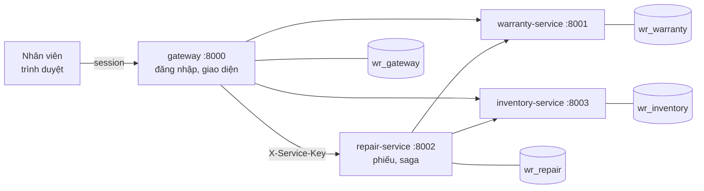
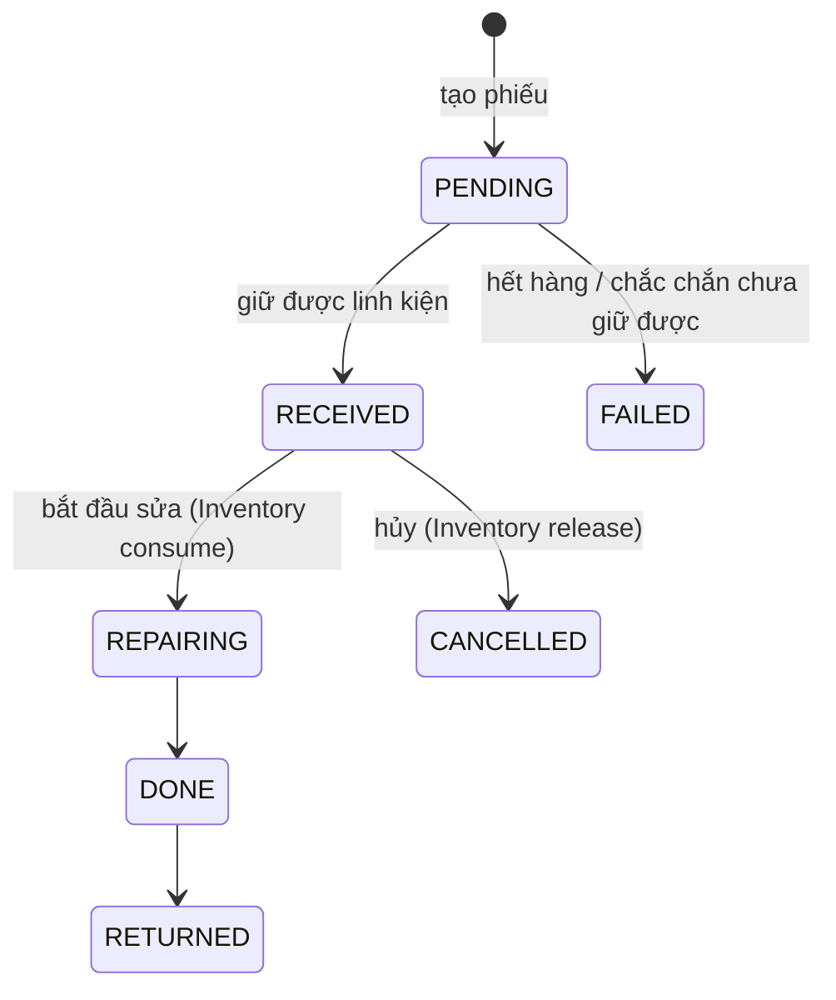
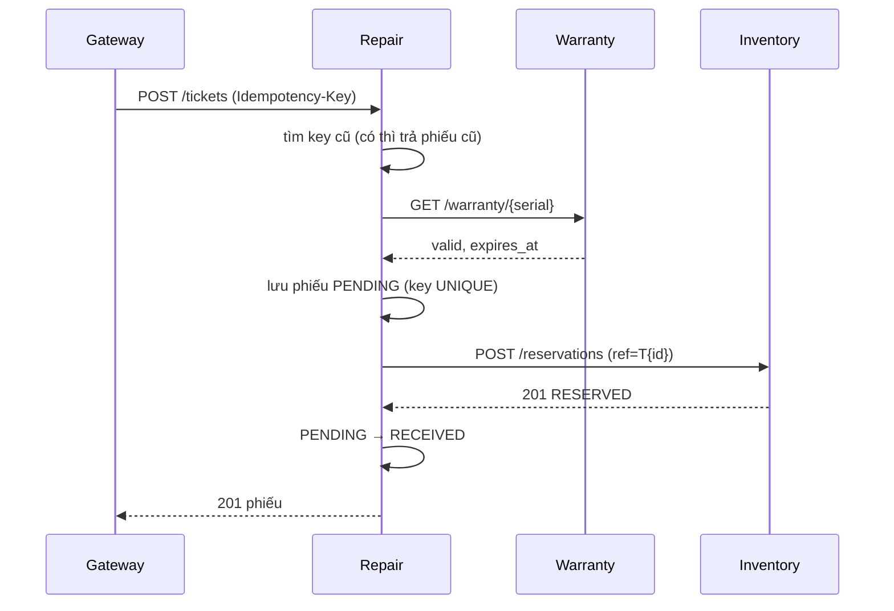
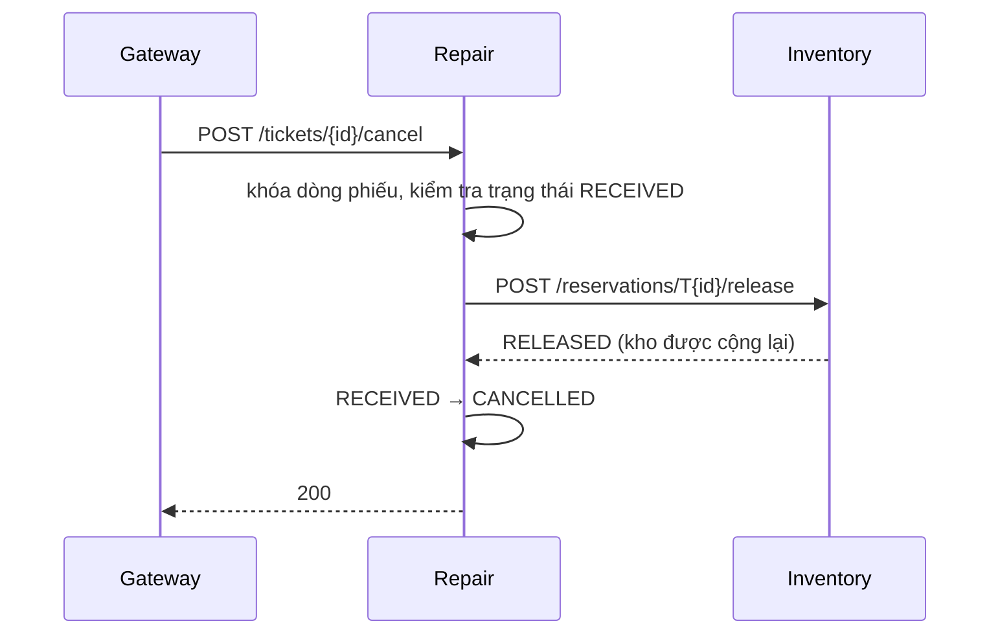
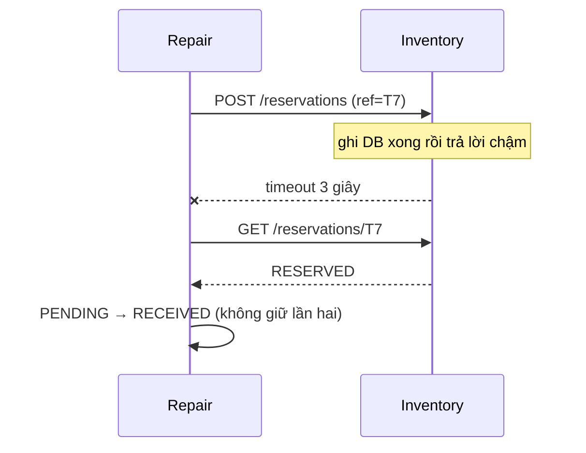

# Báo cáo: Hệ thống tiếp nhận bảo hành và sửa chữa thiết bị

## 1. Yêu cầu và phạm vi

Hệ thống cho nhân viên cửa hàng tiếp nhận thiết bị đến bảo hành/sửa chữa: kiểm tra hạn bảo hành, mở phiếu, giữ linh kiện cần thay, theo dõi vòng đời phiếu và hủy phiếu.

| Yêu cầu của đề | Cách đáp ứng |
|---|---|
| ≥ 3 dịch vụ nghiệp vụ, tiến trình riêng, giao tiếp qua API | Warranty (8001), Repair (8002), Inventory (8003); REST/JSON qua HTTP |
| Mỗi dịch vụ có trách nhiệm và dữ liệu riêng | Mỗi dịch vụ một schema MySQL, không khóa ngoại và không query chéo (mục 3) |
| Một quy trình phối hợp cả 3 dịch vụ | Tạo phiếu: Warranty → Repair → Inventory (mục 5.1) |
| Một dịch vụ dùng ở ≥ 2 quy trình | Inventory dùng ở tạo phiếu (giữ), hủy phiếu (trả) và bắt đầu sửa (dùng) |
| Giao diện đủ cho luồng chính | Gateway: đăng nhập, danh sách, tạo phiếu, chi tiết, đổi trạng thái, hủy, kho (giao diện tạm) |
| Đăng nhập xử lý hợp lý, không tính là dịch vụ nghiệp vụ | Gateway đăng nhập session; dịch vụ con chỉ nhận request có `X-Service-Key` |
| Giả lập dịch vụ ngoài với trạng thái thành công/lỗi/chậm | Inventory nhận `X-Simulate: fail | slow | commit-then-timeout` khi `APP_SIMULATE=true` |
| Xử lý ≥ 2 vấn đề đặc thù | Cả bốn: đồng thời, yêu cầu lặp, lỗi giữa quy trình (bù trừ), hủy/đổi (mục 6) |
| Chậm không phải lỗi: tra trạng thái trước khi gửi lại/hủy/bù trừ | Mục 6.3 |

Ngoài phạm vi (đã thu gọn): thanh toán, thông báo, phân quyền theo vai trò, hàng đợi/broker, phân trang.

## 2. Kiến trúc

- Gateway không chứa nghiệp vụ: xác thực nhân viên, gọi dịch vụ và hiển thị.
- Repair là bộ điều phối (saga) của luồng tạo phiếu và hủy phiếu.
- Mỗi dịch vụ theo luồng Controller → Validator → Service → Repository → Model.
- Công nghệ: Laravel 13, PHP 8.4, MySQL 8; chạy bằng `./run-all.sh` hoặc `docker compose up --build`.

## 3. Dữ liệu từng dịch vụ

| Dịch vụ | Bảng | Cột chính |
|---|---|---|
| Warranty | `devices` | `serial` UNIQUE, `model`, `purchase_date`, `warranty_months` |
| Repair | `tickets` | `serial`, `customer`, `phone`, `issue`, `in_warranty`, `status`, `part_id`, `qty`, `idempotency_key` UNIQUE, `request_hash`, `failure_reason` |
| Repair | `ticket_events` | `ticket_id`, `from_status`, `to_status`, `note` (lịch sử đổi trạng thái) |
| Inventory | `parts` | `name`, `available` |
| Inventory | `reservations` | `ref` UNIQUE, `part_id`, `qty`, `status` (RESERVED / RELEASED / CONSUMED) |
| Gateway | `users` | tài khoản nhân viên |

Vòng đời phiếu:

`PENDING` còn lại khi chưa thể xác định kết quả giữ linh kiện; lệnh đối soát sẽ xử lý tiếp.

## 4. Hợp đồng API

Mọi request tới dịch vụ con cần header `X-Service-Key`. Lỗi trả dạng `{ "message": "...", "error_code": "..." }`. Bộ request mẫu đầy đủ: `postman/warranty-repair.postman_collection.json`.

### Warranty (8001)

| Method | Đường dẫn | Kết quả |
|---|---|---|
| GET | `/devices` | Danh sách thiết bị kèm `valid`, `expires_at` |
| GET | `/warranty/{serial}` | `data: {serial, model, purchase_date, warranty_months, expires_at, valid}`; 404 `device_not_found` |

### Inventory (8003)

| Method | Đường dẫn | Kết quả |
|---|---|---|
| GET | `/parts` | Danh sách linh kiện và tồn kho |
| POST | `/reservations` | Body `{ref, part_id, qty}`; 201 giữ mới, 200 gửi lại cùng `ref`; 409 `out_of_stock`; 404 `part_not_found` |
| GET | `/reservations/{ref}` | Tra lượt giữ; 404 `reservation_not_found` |
| POST | `/reservations/{ref}/release` | Trả kho, idempotent; 409 `already_consumed` |
| POST | `/reservations/{ref}/consume` | Đánh dấu đã dùng, idempotent; 409 `already_released` |

### Repair (8002)

| Method | Đường dẫn | Kết quả |
|---|---|---|
| POST | `/tickets` | Header `Idempotency-Key` bắt buộc; body `{serial, customer, phone, issue, part_id, qty}`. 201 tạo mới; 200 gửi lại; 202 chưa rõ kết quả (PENDING); 409 `out_of_stock` / `idempotency_key_conflict`; 422 `device_not_found` / `validation_failed`; 503 `warranty_unavailable` / `inventory_unavailable` |
| GET | `/tickets?status=` | Danh sách (mới nhất trước, tối đa 100) |
| GET | `/tickets/{id}` | Chi tiết kèm `events` |
| POST | `/tickets/{id}/status` | Body `{status}`; 422 `invalid_transition`; 503 khi Inventory lỗi (phiếu giữ nguyên) |
| POST | `/tickets/{id}/cancel` | 409 `ticket_pending` / `cancel_not_allowed` |
| POST | `/tickets/reconcile` | Body `{older_than}` (giây, mặc định 60); trả `{checked, received, failed, pending}` |

Header `X-Simulate` gửi tới Repair được chuyển tiếp xuống Inventory.

## 5. Sơ đồ tuần tự

### 5.1 Tạo phiếu (cả 3 dịch vụ)

### 5.2 Hủy phiếu

### 5.3 Giữ linh kiện bị timeout (trạng thái chưa rõ)

Nếu tra cứu trả 404 thì Repair gửi lại cùng `ref` một lần (idempotent), sau đó tra thêm một lần nữa. Chỉ khi chắc chắn kho không có lượt giữ mới đánh `FAILED`; không tra được thì để `PENDING`.

## 6. Xử lý các vấn đề đặc thù

### 6.1 Đồng thời

Trừ kho bằng một câu lệnh nguyên tử `UPDATE parts SET available = available - :qty WHERE id = :id AND available >= :qty`; số dòng bị ảnh hưởng bằng 0 nghĩa là hết hàng. Hai lệnh cùng tranh linh kiện cuối: đúng một lệnh thắng, kho không âm. `release`/`consume` khóa dòng lượt giữ (`SELECT ... FOR UPDATE`) để không cộng/dùng hai lần. Repair khóa dòng phiếu khi đổi trạng thái hoặc hủy nên hai thao tác trùng nhau phải xếp hàng.

### 6.2 Yêu cầu lặp

- Repair: `Idempotency-Key` UNIQUE; gửi lại trả phiếu cũ (200), không tạo phiếu hay giữ kho lần nữa. Cùng key nhưng khác nội dung (`request_hash`) trả 409. Hai yêu cầu cùng key song song: ràng buộc UNIQUE đảm bảo chỉ một phiếu.
- Inventory: `ref` UNIQUE; giữ lại cùng `ref` trả lượt cũ, `release`/`consume` lặp trả kết quả cũ.
- Gateway: form mang sẵn khóa sinh một lần, nên bấm đúp hay F5 chỉ tạo một phiếu.

### 6.3 Lỗi giữa quy trình và trạng thái chưa rõ

Phân biệt hai loại kết quả khi gọi dịch vụ khác:

| Loại | Dấu hiệu | Xử lý |
|---|---|---|
| Rõ: bị từ chối | HTTP 4xx nghiệp vụ (hết hàng, không tìm thấy) | Kết thúc ngay: phiếu `FAILED` |
| Chưa rõ | Timeout, mất kết nối, 5xx | Không đoán: tra `GET /reservations/{ref}` trước khi gửi lại, hủy hay bù trừ |

- Tạo phiếu: quy trình ở mục 5.3. Phiếu `PENDING` quá 60 giây được đối soát bằng `php artisan tickets:reconcile` hoặc `POST /tickets/reconcile`.
- Hủy phiếu: nếu `release` bị timeout thì tra lượt giữ; đã `RELEASED` thì coi như hủy thành công, chưa rõ thì trả 503 và giữ phiếu nguyên để thử lại.
- Bắt đầu sửa: `consume` lỗi thì phiếu giữ `RECEIVED`, gửi lại an toàn vì `consume` idempotent.
- Warranty chỉ đọc nên lỗi ở bước này không lưu gì, client gửi lại bình thường.

### 6.4 Hủy và đổi

Chỉ hủy được phiếu `RECEIVED` (trả linh kiện). Phiếu `PENDING` trả 409 `ticket_pending`; phiếu đang sửa, đã xong hoặc đã trả trả 409 `cancel_not_allowed` vì linh kiện đã dùng. Hủy lặp trả 200 và không cộng kho lần hai. Đổi trạng thái chỉ theo thứ tự `RECEIVED → REPAIRING → DONE → RETURNED`.

## 7. Kiểm thử

Lệnh chạy và cách tái hiện nằm ở `README.md`. Kết quả của lần chạy cuối:

| Loại | Phạm vi | Kết quả |
|---|---|---|
| PHPUnit `warranty-service` | tra cứu, hết hạn, đúng ngày hết hạn, serial lạ, sai key | 6 test đạt |
| PHPUnit `inventory-service` | giữ/trả/dùng, idempotent theo ref, hết hàng, simulate fail | 13 test đạt |
| PHPUnit `repair-service` | tạo phiếu, idempotency, timeout trước/sau khi ghi, lỗi liên tục, PENDING, đối soát, vòng đời, hủy | 31 test đạt |
| PHPUnit `gateway` | chặn khách chưa đăng nhập, đăng nhập, form, chuyển `Idempotency-Key`/`X-Simulate`, xử lý lỗi dịch vụ | 17 test đạt |
| `scripts/e2e.sh` (curl, dịch vụ thật, MySQL) | 12 nhóm tình huống gồm simulate `fail`/`slow`/`commit-then-timeout` và đăng nhập qua gateway | tất cả đạt, trên máy và trong Docker |
| `scripts/concurrency.sh` | 10 yêu cầu song song vào linh kiện còn 1; cùng `ref`; cùng `Idempotency-Key` | đúng 1 thành công, kho = 0, một phiếu |
| `postman/*.json` | 37 request có script kiểm tra; chạy bằng Collection Runner | chưa chạy thử trong Postman |

Ghi chú: test PHPUnit chạy trên SQLite in-memory nên không kiểm khóa dòng của MySQL; phần đó được kiểm bằng `scripts/concurrency.sh`.

## 8. Phân công và tự đánh giá

| Hạng mục | Người thực hiện | Mức hoàn thành |
|---|---|---|
| Thiết kế kiến trúc, 4 ứng dụng, Docker | Nhóm 1 người | Hoàn thành |
| Warranty, Inventory, Repair (backend) | Nhóm 1 người | Hoàn thành |
| Gateway (đăng nhập, giao diện tạm) | Nhóm 1 người | Hoàn thành giao diện tạm, sẽ làm đẹp sau |
| Kiểm thử, Postman, báo cáo | Nhóm 1 người | Hoàn thành, Postman chưa chạy thử |

Hạn chế đã biết: chỉ có một vai trò nhân viên; đối soát phải chạy tay (không có lịch tự động); khóa dòng phiếu giữ trong lúc gọi Inventory nên mỗi phiếu chỉ xử lý được một thao tác tại một thời điểm.
